<p align="center">
  
</p>

# DYNAMIXEL-X430-Control-Table-Emulator

**Any motor as a DYNAMIXEL X430 — device-side emulation of the X430 Control Table over
Protocol 2.0, in portable C11.** Your firmware drives a stepper, a BLDC or a simulation;
the host sees an X430-compatible device. Verified end to end with the official
DynamixelSDK and with DYNAMIXEL Wizard 2.0 on hardware; built for ROS 2
`dynamixel_hardware_interface`.

[](https://github.com/AntonVynohradov/DYNAMIXEL-X430-Control-Table-Emulator/actions/workflows/google-unit-tests.yml)
[](https://github.com/AntonVynohradov/DYNAMIXEL-X430-Control-Table-Emulator/actions/workflows/static-analysis.yml)
[](https://github.com/AntonVynohradov/DYNAMIXEL-X430-Control-Table-Emulator/actions/workflows/models-and-sdk.yml)
[](https://antonvynohradov.github.io/DYNAMIXEL-X430-Control-Table-Emulator/)
[](LICENSE)

[Documentation](https://antonvynohradov.github.io/DYNAMIXEL-X430-Control-Table-Emulator/) ·
[PDF manual](https://antonvynohradov.github.io/DYNAMIXEL-X430-Control-Table-Emulator/downloads/DYNAMIXEL-X430-Control-Table-Emulator_User_Manual.pdf) ·
[API reference](https://antonvynohradov.github.io/DYNAMIXEL-X430-Control-Table-Emulator/api/) ·
[Changelog](CHANGELOG.md)

## Overview

| Capability | What the library does |
| --- | --- |
| Models | All 17 X430 models (XM, XH, XD, XW, XL, XC, 2XL, 2XC430), one per build; Control Tables generated from `models/*.yaml` and checked against the ROBOTIS e-Manual tables |
| Instructions | PING, READ, WRITE, REG_WRITE, ACTION, FACTORY_RESET, REBOOT, CLEAR, BACKUP, SYNC_READ/WRITE, BULK_READ/WRITE, FAST_SYNC_READ, FAST_BULK_READ; broadcast and Secondary ID; several buses (MCUs) on one wire take turns like X series actuators |
| Device rules | Access rights, ranges and limit registers, EEPROM lock while the torque is on, Indirect Address/Data, Status Return Level, Return Delay Time, Bus Watchdog, hardware error shutdown and alert bit, Startup Configuration, Drive Mode "torque on by goal update" |
| Your motor | Five hooks per device (write, read, event, nvm_read, nvm_write); live registers updated with `x430_device_set()` |
| Platform | One byte writer and an optional port (lock, millisecond clock, delay); bare metal, Zephyr, FreeRTOS, POSIX |
| Simulator | Optional kinematic model with the X430 profiles, and a POSIX host simulator on a pseudo-terminal |
| Configuration | Kconfig (Kconfiglib) or plain compiler definitions; application overrides of the model data |

### Measured figures

Cortex-M4, `arm-none-eabi-gcc` 13.2.1, XM430-W350, default options (768-byte packets:
a READ of the whole Control Table, as DYNAMIXEL Wizard does it)
([details](https://antonvynohradov.github.io/DYNAMIXEL-X430-Control-Table-Emulator/configuration/#memory-footprint)):

| Figure | Value |
| --- | --- |
| RAM per device / per bus / per simulator | 384 B / 2,424 B / 32 B (bus: 888 B with 256-byte packets) |
| Flash, `-Os`, with the model table | 10,191 B (+ 850 B DXL2-C); 7,027 B without the optional features |
| `.data` + `.bss` | 0 B |
| Worst-case stack, `x430_bus_receive()`, `-Os` | 424 B (any packet size) |
| MISRA C:2012 (Cppcheck 2.13) | 0 violations, 2 documented deviations |
| Unit tests | 137 GoogleTest cases, 100 % line and branch coverage of `src/` (104 cases and 100 % without the optional features) |
| End to end | 52 checks with the official ROBOTIS DynamixelSDK pass |

The simulator follows the X430 profiles: a one-turn move with Profile Velocity 100 and
Profile Acceleration 20 takes 2,920 ms, the closed-form trapezoid 2,940.3 ms (−0.69 %).

## Project status

**Version 1.1.0** — several emulator buses (one per MCU) share one DYNAMIXEL wire; the
public API (`x430.h`, `inc/`) is stable within major version 1. Verified on hardware in a
stepper joint firmware (STM32G431, Zephyr) with DYNAMIXEL Wizard 2.0.

- [x] All X430 models, all Protocol 2.0 instructions a host uses
- [x] Persistence, backup, Bus Watchdog, shutdown, Indirect Address
- [x] Simulator and POSIX host simulator; DynamixelSDK end-to-end check
- [x] MISRA C:2012, 100 % coverage, sanitizers, documentation and PDF manual
- [ ] Other DYNAMIXEL families (X330, X540) as model data

## Quick start

```c
#include "x430.h"

static struct x430_bus bus;
static struct x430_device joint;

static int uart_write(void* context, const uint8_t* data, size_t length)
{
    (void)context;
    return board_uart_write(data, length); /* 0 on success */
}

static uint8_t on_write(struct x430_device* device, uint16_t address, uint8_t size,
                        int32_t value, void* user_data)
{
    (void)device;
    (void)size;
    (void)user_data;
    if (address == X430_ADDR_GOAL_POSITION)
    {
        motor_move_to(value); /* your motion control */
    }
    return DXL2_ERR_NONE;
}

static const struct x430_hooks hooks = {.write = on_write};

int main(void)
{
    const struct x430_bus_config bus_config = {.write = uart_write};
    const struct x430_device_config joint_config = {.id = 1U, .hooks = &hooks};

    if ((x430_bus_init(&bus, &bus_config) != X430_OK) ||
        (x430_device_init(&joint, &joint_config) != X430_OK) ||
        (x430_bus_attach(&bus, &joint) != X430_OK))
    {
        for (;;)
        {
        }
    }
    for (;;)
    {
        uint8_t bytes[64];
        const size_t count = board_uart_read(bytes, sizeof(bytes));

        (void)x430_bus_receive(&bus, bytes, count); /* parse, check, hooks, answer */
        (void)x430_bus_lock(&bus);
        (void)x430_device_set(&joint, X430_ADDR_PRESENT_POSITION, motor_position());
        (void)x430_bus_unlock(&bus);
        (void)x430_bus_poll(&bus); /* Bus Watchdog */
    }
}
```

The `board_…` and `motor_…` functions stand for your UART and motor code.

## Building

Requirements: a C11 compiler, CMake 3.20+, Python 3. Optional: GoogleTest and gcovr,
Cppcheck 2.13, clang-format 18, Kconfiglib, `requirements-dev.txt` for the documentation.

| Preset | Purpose |
| --- | --- |
| `X430[Debug]`, `X430[Release]` | Static library (XM430-W350) |
| `X430[UnitTests]` | GoogleTest suite; target `coverage` (100 % gate) |
| `X430[UnitTestsMinimal]` | The same without the optional features |
| `X430[Kconfig]` | Kconfiglib with `configs/defconfig`; target `menuconfig` |
| `X430[Examples]` | POSIX host simulator `x430_host_sim` |

```bash
cmake --preset "X430[Debug]" -DX430_MODEL=xl430_w250
cmake --build "build/X430[Debug]"
cmake --preset "X430[UnitTests]" && cmake --build "build/X430[UnitTests]" --target coverage
cmake --build "build/X430[Debug]" --target misra-analyze
```

In your CMake project:

```cmake
set(X430_MODEL xm430_w350)
set(COMPILE_DEFINITIONS X430_MAX_DEVICES=2U)   # options of x430_config.h
set(COMPILE_OPTIONS -Os)                       # flags of the library sources
include(path/to/DYNAMIXEL-X430-Control-Table-Emulator/x430.cmake)
target_link_libraries(app PRIVATE x430)
```

Main options: `COMPILE_DEFINITIONS`, `COMPILE_OPTIONS`, `UNIT_TESTS` (also builds the unit
tests of this library when it is a submodule), `X430_KCONFIG` (off by default),
`X430_CONF_FILES`, `X430_MODEL`, `X430_MODEL_OVERRIDES`, `X430_DXL2_MAX_PACKET_SIZE` (768),
`FETCHCONTENT_SOURCE_DIR_DXL2` — see
[Configuration](https://antonvynohradov.github.io/DYNAMIXEL-X430-Control-Table-Emulator/configuration/).

## Project structure

```text
DYNAMIXEL-X430-Control-Table-Emulator/
├── x430.h, x430.cmake        public API; library target (include() it)
├── inc/                      public types, definitions, configuration, model descriptor
├── src/                      x430_bus.c, x430_device.c, x430_sim.c, x430_internal.h
├── models/                   Control Tables: x430_family.yaml + x430/<model>.yaml
├── Kconfig, Kconfig.x430     Kconfig tree; configs/defconfig
├── tools/                    x430_gen_model.py, x430_kconfig.py, x430_measure.sh, docs/
├── cmake/                    version, unit tests, MISRA, Kconfig
├── examples/host_sim/        POSIX serial/pty simulator
├── tests/                    unit/ (GoogleTest), compile/, models/, sdk/ (DynamixelSDK)
└── docs/, overrides/         MkDocs website and PDF manual sources
```

## Documentation

The [documentation website](https://antonvynohradov.github.io/DYNAMIXEL-X430-Control-Table-Emulator/)
and the [PDF user manual](https://antonvynohradov.github.io/DYNAMIXEL-X430-Control-Table-Emulator/downloads/DYNAMIXEL-X430-Control-Table-Emulator_User_Manual.pdf)
are built from `docs/`: `mkdocs serve`, `mkdocs build`, `python tools/docs/build_manual.py`.

## Author

**Anton Vynohradov** — Embedded Systems Engineer · Secure Product Architect · Founder of
SystemFromScratch®

[systemfromscratch.com](https://systemfromscratch.com) ·
[GitHub](https://github.com/AntonVynohradov) ·
[LinkedIn](https://www.linkedin.com/in/vynohradov) ·
[ORCID 0009-0005-6965-0911](https://orcid.org/0009-0005-6965-0911) ·
[contact@systemfromscratch.com](mailto:contact@systemfromscratch.com)

## Releases and versioning

[Semantic Versioning](https://semver.org); the version comes only from the `vX.Y.Z` Git
tag. Each [GitHub Release](https://github.com/AntonVynohradov/DYNAMIXEL-X430-Control-Table-Emulator/releases)
contains the static libraries for Linux x86-64 built with the default options (XM430-W350,
every feature) — `libx430.a` and `libdxl2.a` with all headers they need, including the
generated model header — the MISRA report and the PDF manual. MCU firmware and
other models build the library from source.

## Contributing

Issues and pull requests are welcome. Keep the rules of
[Extending the Library](https://antonvynohradov.github.io/DYNAMIXEL-X430-Control-Table-Emulator/extending/#contributing-to-the-library):
100 % coverage in both unit test presets, 0 MISRA violations, `clang-format` 18, measured
figures and `CHANGELOG.md` up to date.

## License

Copyright © 2026 Anton Vynohradov. Licensed under the [Apache License 2.0](LICENSE).

SystemFromScratch® is a registered trademark. The Apache License 2.0 grants no rights to use
the SystemFromScratch® name or logo; they may not be used to endorse or promote products
derived from DYNAMIXEL-X430-Control-Table-Emulator without prior written permission.

DYNAMIXEL and ROBOTIS are trademarks of ROBOTIS Co., Ltd.; STM32 is a registered trademark
of STMicroelectronics International N.V. This is an independent implementation and is not
affiliated with or endorsed by ROBOTIS or STMicroelectronics.

## References

- [DYNAMIXEL Protocol 2.0](https://emanual.robotis.com/docs/en/dxl/protocol2/) — ROBOTIS e-Manual
- [DYNAMIXEL X series](https://emanual.robotis.com/docs/en/dxl/x/) — Control Tables of the X430 models
- [DXL2-C](https://github.com/AntonVynohradov/DXL2-C) — the Protocol 2.0 codec this library uses
- [MISRA C:2012](https://misra.org.uk/) — Guidelines for the use of the C language in critical systems
