# Author & Company

{ .sfs-brand__logo }

DYNAMIXEL-X430-Control-Table-Emulator is designed, written and maintained by **Anton Vynohradov** and published by
**SystemFromScratch®** — secure embedded systems and compliance-ready engineering, from
concept to certification-ready product.

## Author

**Anton Vynohradov** · [ORCID 0009-0005-6965-0911](https://orcid.org/0009-0005-6965-0911)
{ .sfs-author__name }

Embedded Systems Engineer · Secure Product Architect · Founder of SystemFromScratch®
{ .sfs-author__role }

*Embedded systems built from scratch — from bare metal to Linux, from first schematic to
certification.*

Anton designs and builds reliable, secure embedded products end to end: firmware, board
support packages and drivers, RTOS and Embedded Linux platforms, hardware bring-up, and
the security and compliance work needed to ship them. He is based in Poland and works
remotely worldwide.

| Area | Focus |
| --- | --- |
| Embedded software | Bare-metal, RTOS and Linux firmware in C/C++, built to be maintained for years |
| BSP & drivers | Bootloaders, Zephyr drivers and Linux kernel work for MCUs, SoCs and SoC FPGAs |
| Security & compliance | Secure boot, threat modelling, MISRA C/C++, EU Cyber Resilience Act (CRA) readiness |
| Industries | Industrial IoT, automotive, robotics, medical and consumer electronics |

**Technology:** C · C++ · Python · Zephyr RTOS · FreeRTOS · Embedded Linux · Yocto ·
Buildroot · ARM Cortex-M · STM32 · Microchip FPGA · RISC-V · CAN / ISO-TP · ROS 2 ·
Docker · Git · CI/CD · MISRA C/C++ · EU CRA

For DYNAMIXEL-X430-Control-Table-Emulator, Anton wrote the library, the model data and
its generator, the unit tests and the end-to-end check with DynamixelSDK, the host
simulator and this documentation, and verified the library on a stepper joint with
DYNAMIXEL Wizard 2.0.

## SystemFromScratch®

SystemFromScratch® was founded by Anton Vynohradov. The company combines deep embedded
engineering with cybersecurity and certification-focused product development, for teams
in industrial IoT, automotive, robotics, medical and consumer electronics that need a
partner who understands the whole stack — silicon, firmware, operating system and the
regulations that govern them.

| Service | What it covers |
| --- | --- |
| Hardware design with partners | Component selection, second sourcing and hardware design with partner engineers: proven, available parts instead of one expensive supplier |
| Hardware bring-up & integration | From the first power-on of a new board to a working system: first boot and validation (STM32, SmartFusion2) |
| BSP & device drivers | Board support packages, bootloaders (MCUboot) and drivers for Zephyr, the Linux kernel and FPGAs that keep timing exact |
| RTOS & Embedded Linux | A maintained, secure foundation on Zephyr, FreeRTOS or Embedded Linux (Yocto, Buildroot) |
| Embedded software development | Devices that talk to each other reliably over CAN, ISO-TP, RS-485, UART, SPI and I²C, even when the hardware underneath changes |
| System integration | Systems that work end to end and can be tested on a laptop before the hardware exists: software-in-the-loop, Docker, CI/CD, ROS 2 |
| Cybersecurity, CRA & compliance | Secure boot, signed updates, threat modelling and MISRA C:2012 designed in from the start, so EU Cyber Resilience Act conformity is not a last-minute patch |

DYNAMIXEL-X430-Control-Table-Emulator is one of the open-source projects in the SystemFromScratch® portfolio: public
engineering work that can be inspected line by line, built with the same rules — MISRA C,
full test coverage, documented decisions — that the company applies to customer products.

## Contact

| Channel | Address |
| --- | --- |
| Website | [systemfromscratch.com](https://systemfromscratch.com) |
| E-mail | [contact@systemfromscratch.com](mailto:contact@systemfromscratch.com) |
| GitHub | [github.com/AntonVynohradov](https://github.com/AntonVynohradov) |
| GitHub organization | [github.com/SystemFromScratch](https://github.com/SystemFromScratch) |
| LinkedIn | [linkedin.com/in/vynohradov](https://www.linkedin.com/in/vynohradov) |
| ORCID | [0009-0005-6965-0911](https://orcid.org/0009-0005-6965-0911) |
| Location | Poland — working remotely worldwide |

Building a connected product, bringing up new hardware, or preparing for the Cyber
Resilience Act? Get in touch through [systemfromscratch.com](https://systemfromscratch.com)
or by e-mail.

## Support and feedback

- **Bugs and feature requests:** open an issue on
  [GitHub](https://github.com/AntonVynohradov/DYNAMIXEL-X430-Control-Table-Emulator/issues). Please include the library
  version, your compiler and target, the configuration values, and a minimal program or
  test that shows the problem.
- **Contributions:** see [Contributing to the library](extending.md#contributing-to-the-library).
- **Commercial support, integration and custom development:** contact SystemFromScratch®
  through [systemfromscratch.com](https://systemfromscratch.com).

## Trademarks and acknowledgements

SystemFromScratch® is a registered trademark. The SystemFromScratch® name and logo are used
in this documentation to identify the publisher of DYNAMIXEL-X430-Control-Table-Emulator; the Apache License 2.0 grants
no rights to use them, and they may not be used to endorse or promote products derived
from DYNAMIXEL-X430-Control-Table-Emulator without prior written permission.

DYNAMIXEL and ROBOTIS are trademarks of ROBOTIS Co., Ltd. The X430 model names identify the
emulated devices. DYNAMIXEL-X430-Control-Table-Emulator is an independent implementation of
the documented Protocol 2.0 and Control Tables; it is not affiliated with or endorsed by
ROBOTIS. STM32 is a registered trademark of STMicroelectronics International N.V.; it
names the test hardware only.

The Control Table data were transcribed from the ROBOTIS e-Manual; the Protocol 2.0 codec
is DXL2-C by the same author.
