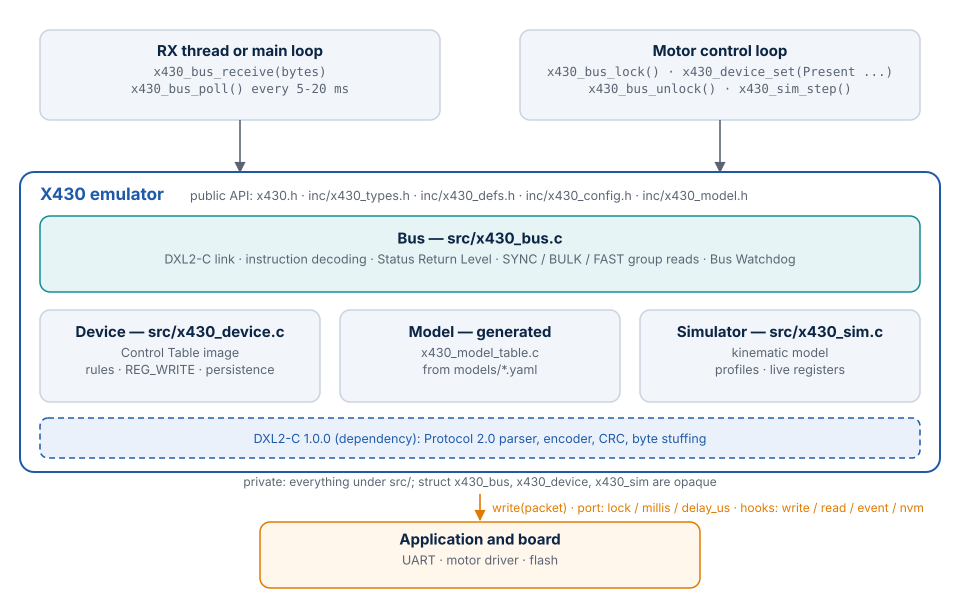
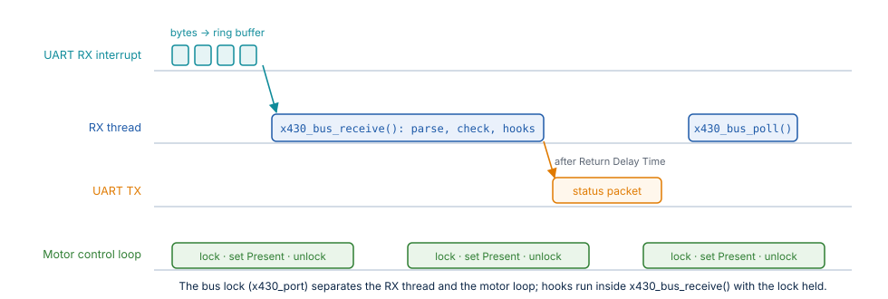
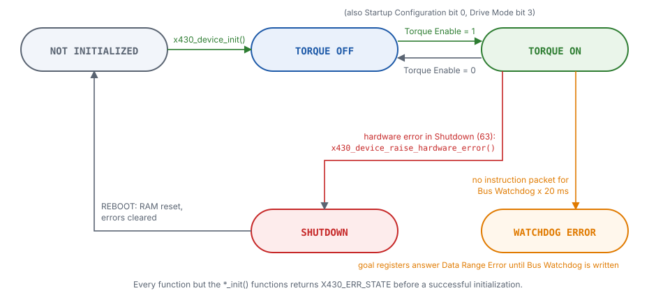

# How It Works

This chapter explains the parts of the X430 emulator, the contexts it runs in, the states
of a device, who owns which memory, how errors are reported and what may run in parallel.
What a host sees, instruction by instruction, is in [X430 Emulation](theory.md).

## Modules

| Module | Files | Responsibility |
| --- | --- | --- |
| Public API | `x430.h`, `inc/x430_types.h`, `inc/x430_defs.h`, `inc/x430_config.h`, `inc/x430_model.h` | Functions, configuration types, hooks, status codes, Control Table addresses, build-time options, the model descriptor type |
| Bus | `src/x430_bus.c` | DXL2-C link, addressing (ID, Secondary ID, broadcast), Status Return Level, Return Delay Time, single and group instructions, Fast read packets, Bus Watchdog timing, the bus lock |
| Device | `src/x430_device.c` | Control Table image, write checks, write hook and storage, Indirect Address, REG_WRITE/ACTION, REBOOT, FACTORY_RESET, CLEAR, BACKUP, hardware errors, persistent blocks |
| Model | `<build>/x430/generated/x430_model_table.c`, `x430_model_info.h` | The register list and address map of the selected model, written by `tools/x430_gen_model.py` from `models/` |
| Simulator | `src/x430_sim.c` | Kinematic model of the actuator behind a device (optional) |
| DXL2-C | dependency | Protocol 2.0 parser, encoder, CRC-16, byte stuffing |

Only the public API is visible to the application. Everything under `src/` is private: the
instances `struct x430_bus`, `struct x430_device` and `struct x430_sim` are opaque blocks
of memory whose layout may change in any release.

## Execution contexts

| | Bus context | Motor context |
| --- | --- | --- |
| Functions | `x430_bus_receive()`, `x430_bus_handle_packet()`, `x430_bus_poll()` | `x430_bus_lock()`, `x430_device_set()` / `x430_device_get()`, `x430_bus_unlock()`, `x430_sim_step()` |
| Context | One RX thread or the main loop, never an interrupt | The motor control loop (task or main loop) |
| Rate | As bytes arrive; `x430_bus_poll()` every 5–20 ms | The rate of the control loop (for example 1 kHz) |
| Work | Parse, check, call the hooks, store, answer | Copy the motor state into the live registers |
| Time | Bounded by the packet: loops over its parameters, the touched registers, the devices of the bus | Bounded; `x430_sim_step()` is proportional to its `elapsed_ms` |

The two contexts share the Control Tables. The bus functions take the bus lock
(`x430_port::lock`) for the whole packet; the motor context takes the same lock around its
updates with `x430_bus_lock()`. On bare metal both run in the main loop and the port has
no lock.

Hooks run inside the bus context with the lock held. A hook may call the lock-free device
functions (`x430_device_get()`, `x430_device_set()`, `x430_device_id()`,
`x430_device_raise_hardware_error()`) but no bus function; to hand work to another thread,
post to an application queue from the hook.

## States

| State | Torque Enable (64) | Entered by | Left by |
| --- | --- | --- | --- |
| Not initialized | – | a zeroed or never initialized instance | `x430_device_init()` |
| Torque off | 0 | initialization, REBOOT, a write of 0, a shutdown | a write of 1, Startup Configuration bit 0, a goal write with Drive Mode bit 3 |
| Torque on | 1 | the transitions above; Goal Position takes Present Position | a write of 0, a hardware error in Shutdown (63) |
| Shutdown | 0, locked | `x430_device_raise_hardware_error()` with a bit enabled in Shutdown | REBOOT (Hardware Error Status cleared) |
| Watchdog error | 1, Bus Watchdog reads −1 | no instruction packet for Bus Watchdog × 20 ms | a write of Bus Watchdog |

While a hardware error bit is set, every status packet carries the alert bit (0x80).

## Memory model

| Object | Owner | Size on Cortex-M4 | Lifetime |
| --- | --- | --- | --- |
| `struct x430_bus` | Application (static, stack or pool) | 3,128 B (768-byte packets, the default), 1,080 B (256-byte packets) | From `x430_bus_init()` |
| `struct x430_device` | Application | 1,400 B (all features), 800 B (no backup) | From `x430_device_init()` |
| `struct x430_sim` | Application | 32 B | From `x430_sim_init()` |
| Configurations | Application; copied by the *_init() functions | – | Only during the call |
| Hooks (`struct x430_hooks`), port (`struct x430_port`) | Application | – | As long as the device or bus (the library keeps a pointer) |
| Model table | Library (`const`, flash) | 2,901 B | Static |

A device holds its Control Table image (662 bytes), the REG_WRITE data
(`X430_REG_WRITE_SIZE`) and the buffer of one persistent block (674 bytes with BACKUP,
76 bytes without). A bus holds the DXL2-C link (two packet-sized buffers), a status data
buffer and, with Fast reads, one more packet buffer. There is no heap, no global or static
mutable variable and no hidden buffer: the sizes are fixed at compile time by
`X430_BUS_WORDS`, `X430_DEVICE_WORDS` and `X430_SIM_WORDS` (plain arithmetic of the
configuration macros, which static analysis can evaluate) and checked against the private
state by `_Static_assert`.

## Error handling

| Situation | Result |
| --- | --- |
| `NULL` instance or argument | `X430_ERR_PARAM`; nothing is changed |
| A device ID above 252, a bus without writer | `x430_device_init()` / `x430_bus_init()` return `X430_ERR_PARAM`; the instance is not changed |
| Any call before a successful initialization | `X430_ERR_STATE`; no hook is called |
| Attaching a device twice | `X430_ERR_STATE` |
| Bus full, ID already used on the bus | `X430_ERR_CONFIG` |
| The byte writer returns non-zero | `x430_bus_receive()` / `x430_bus_handle_packet()` return `X430_ERR_HAL` (once) |
| A feature that is not compiled in | `X430_ERR_UNSUPPORTED` (`x430_device_backup()`, `x430_sim_*()`) |
| An instruction the device refuses | `X430_OK`; the protocol error (`DXL2_ERR_*`) goes into the status packet and into the `error` output |
| Malformed packet (CRC, length) | Dropped by DXL2-C; no answer, as a real device |

Instruction semantics never fail at the API level: an invalid address, length or value is a
protocol error for the host, not an error of the application.

## Threading and reentrancy

- **Per bus:** one bus context; the bus functions are not reentrant for the same bus.
- **Live register updates** from another context go between `x430_bus_lock()` and
  `x430_bus_unlock()`; the lock must be recursive if a hook can lead to code that takes it
  again.
- **Different buses** share nothing and may run in parallel.
- **Hooks** run in the context of the bus function that calls them.

## Design decisions

| Decision | Reason |
| --- | --- |
| One model per build, generated tables | The Control Table is data (YAML checked against the e-Manual), not code; a build carries only the table it needs. |
| Library = table and protocol, motor = application | The same library serves steppers, BLDC drives and the simulator; motion control has no place in a protocol emulator. |
| Two passes for a write: check every register, then hook and store | A multi-register write is all or nothing for the checks, as on the real actuator. |
| Hooks receive real addresses | Indirect Data is resolved by the library; the application needs one write path. |
| Status codes for API misuse, `DXL2_ERR_*` for the host | Errors of the application and errors of the host never mix. |
| Persistent blocks with header and CRC | A block from another model, format or a damaged flash page is ignored; the device starts with factory values. |
| Opaque instances | The application cannot depend on internal fields (MISRA deviation [DEV-01](misra.md#dev-01-rule-113-required-opaque-instances)). |
| `X430_ERR_STATE` before initialization | A zeroed or garbage instance never calls a NULL hook. |
