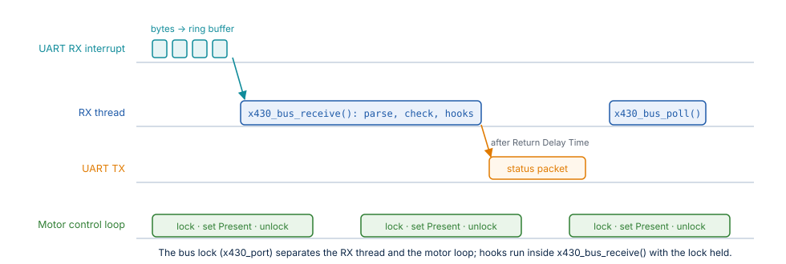
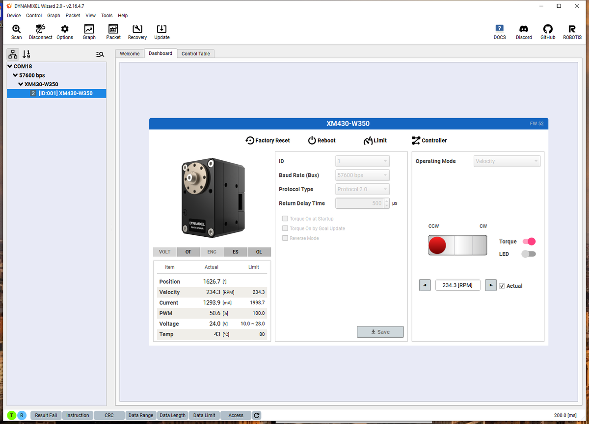
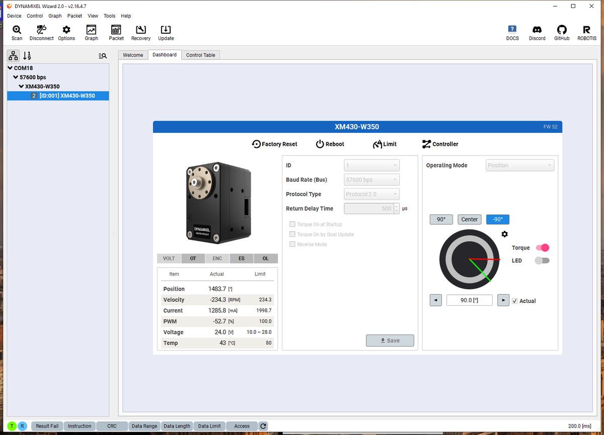
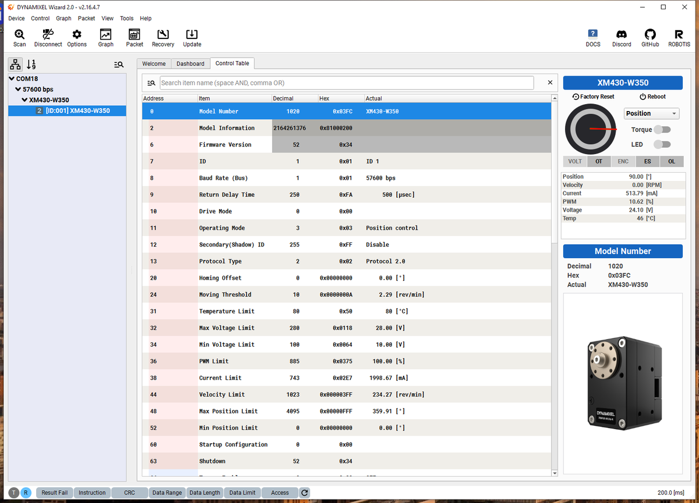
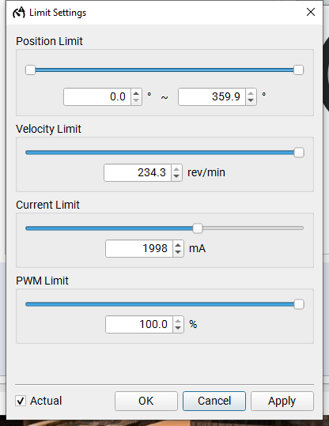

# Integration Guide

The X430 emulator does not touch hardware. An integration has four parts:

1. **Input:** the bytes received on the DYNAMIXEL line (TTL half duplex or RS-485), passed
   to `x430_bus_receive()` in any chunking.
2. **Output:** the byte writer of `struct x430_bus_config`, which sends one complete status
   packet (and switches the direction of a half-duplex line).
3. **The motor:** the hooks of each device and the live register updates.
4. **Contexts and storage:** the port (lock, millisecond clock, delay) and the persistent
   blocks.



## Timing

| Item | Requirement |
| --- | --- |
| `x430_bus_receive()` | As soon as bytes arrive; a status packet is sent from inside the call |
| Return Delay Time (9) | Waited through `x430_port::delay_us` (default 250 × 2 µs = 500 µs) |
| `x430_bus_poll()` | Every 5–20 ms (Bus Watchdog unit 20 ms) |
| Live register updates | At the rate of the control loop, between `x430_bus_lock()` and `x430_bus_unlock()` |
| Interrupts | Never call a library function from an interrupt handler: the UART interrupt only stores bytes |
| Stack of the bus context | 424 B on Cortex-M4 `-Os` (with any packet size), plus the hooks ([Configuration](configuration.md#stack-usage)) |

## Bare metal

```c
static int uart_write(void* context, const uint8_t* data, size_t length)
{
    (void)context;
    return board_uart_write(data, length);
}

static uint32_t millis(void* context)
{
    (void)context;
    return board_millis();
}

static void delay_us(void* context, uint32_t us)
{
    (void)context;
    board_delay_us(us);
}

static const struct x430_port port = {
    .context = NULL, .lock = NULL, .unlock = NULL, .millis = millis, .delay_us = delay_us};

void serve_forever(void)
{
    for (;;)
    {
        uint8_t bytes[64];
        const size_t count = board_uart_read(bytes, sizeof(bytes)); /* from the RX ring */

        (void)x430_bus_receive(&bus, bytes, count);
        if (board_tick_1ms())
        {
            (void)x430_device_set(&joint, X430_ADDR_PRESENT_POSITION, motor_position());
            (void)x430_bus_poll(&bus);
        }
    }
}
```

`bus` and `joint` are set up as in [Using the Library](usage.md#setting-up-a-bus-and-its-devices)
with `.port = &port`. Without a lock everything runs in the main loop.

## RTOS

```text
UART ISR --bytes--> ring buffer --> RX thread: x430_bus_receive()   (lock held inside)
                                        `- hooks --commands--> queue --> motor thread
motor thread: x430_bus_lock(); x430_device_set(Present ...); x430_bus_unlock();
timer or RX thread: x430_bus_poll() every 5-20 ms
```

The lock must be recursive if a hook can lead to code that takes it again. Zephyr mutexes
are recursive:

```c
static void lock(void* context)
{
    mutex_lock(context); /* Zephyr: k_mutex_lock(context, K_FOREVER) */
}

static void unlock(void* context)
{
    mutex_unlock(context); /* Zephyr: k_mutex_unlock(context) */
}

static const struct x430_port rtos_port = {
    .context = &bus_mutex, .lock = lock, .unlock = unlock, .millis = port_millis,
    .delay_us = port_delay_us};
```

FreeRTOS: `xSemaphoreTakeRecursive` / `xSemaphoreGiveRecursive`, `xTaskGetTickCount`
converted to milliseconds. POSIX: a `pthread_mutex_t` of type `PTHREAD_MUTEX_RECURSIVE`
(see `examples/host_sim/x430_host_sim.c`).

## Events

The event `X430_EVENT_BAUD_RATE` arrives after the status packet of the write that changed
Baud Rate (8), so the answer leaves at the old rate:

```c
static uint8_t on_event(struct x430_device* device, enum x430_event event, void* user_data)
{
    int32_t code = 0;

    (void)user_data;
    if ((event == X430_EVENT_BAUD_RATE) || (event == X430_EVENT_FACTORY_RESET))
    {
        (void)x430_device_get(device, X430_ADDR_BAUD_RATE, &code);
        board_uart_set_baud((uint8_t)code); /* code 1 = 57600 bps, 3 = 1 Mbps */
    }
    else if ((event == X430_EVENT_BUS_WATCHDOG) || (event == X430_EVENT_TORQUE_SHUTDOWN))
    {
        motor_stop();
    }
    else
    {
        /* reboot, clear, backup restored */
    }
    return DXL2_ERR_NONE;
}
```

## Persistent storage

The EEPROM area (76-byte block) and the backup (328-byte block) are opaque byte blocks with
a header and a CRC ([format](theory.md#persistent-blocks)). The device keeps no copy of
them: it reads and writes them in parts at an offset, so the hooks map directly onto a
memory-mapped flash page or an I²C EEPROM:

```c
static int nvm_read(struct x430_device* device, enum x430_nvm_slot slot, uint16_t offset,
                    uint8_t* data, uint16_t length, void* user_data)
{
    (void)device;
    (void)user_data;
    return flash_read((uint32_t)slot, offset, data, length); /* 0, or negative without data */
}

static int nvm_write(struct x430_device* device, enum x430_nvm_slot slot, uint16_t offset,
                     const uint8_t* data, uint16_t length, void* user_data)
{
    (void)device;
    (void)user_data;
    if (offset == 0U)
    {
        flash_erase((uint32_t)slot); /* a new block starts at offset 0 */
    }
    return flash_write((uint32_t)slot, offset, data, length); /* 0, or negative: Result Fail */
}
```

A block is read as header, payload in chunks of 16 bytes and CRC (checked before anything
is taken from it), then once per register the device takes. It is written as three parts
with increasing offsets — header, payload, CRC — so the last part ends at
`X430_NVM_EEPROM_SIZE` or `X430_NVM_BACKUP_SIZE`; a block cut short by a reset fails its CRC
and the device starts with factory values. To keep the previous block until the new one
is complete, write into a second page and switch pages when the last part arrives.

A key-value store that keeps whole records only (Zephyr NVS or settings, for example)
needs one buffer of `X430_NVM_BACKUP_SIZE` bytes (`X430_NVM_EEPROM_SIZE` without BACKUP)
in the application: collect the parts there and store the record when the last part
arrives; for `nvm_read`, load the record into it at offset 0 and copy from it. All
devices can share that buffer when they are initialized and served from one context: a
device finishes one block (it always starts at offset 0) before it or another device
touches the next.

`nvm_write` is called from the bus context after the change. On an MCU with one flash bank
an erase stalls the CPU: refuse the write (return a negative value, the host gets Result
Fail) while the power stage runs, or copy the parts and write them from another thread.

## Adding the library to a CMake build

```cmake
set(X430_MODEL xm430_w350)
set(COMPILE_DEFINITIONS X430_MAX_DEVICES=2U)  # options of x430_config.h
set(COMPILE_OPTIONS -Os)                      # flags of the library sources
include(path/to/DYNAMIXEL-X430-Control-Table-Emulator/x430.cmake)
target_link_libraries(app PRIVATE x430)
target_link_libraries(x430 PUBLIC zephyr_interface)   # Zephyr applications only
```

With `UNIT_TESTS=ON` in the project, the unit tests of this library are built too
(`x430_gtest`) and run with the project's CTest (`ctest -L x430`); the `x430` library
itself never contains them.

In a Zephyr module, take DXL2-C from a west project instead of FetchContent with
`FETCHCONTENT_SOURCE_DIR_DXL2`, pin it to the tag `x430.cmake` expects
(`X430_DXL2_GIT_TAG`), and put DXL2-C's `cmake/` folder first on `CMAKE_MODULE_PATH`
(Zephyr has a `version.cmake` of its own).

## Host tools

### ROS 2 (`dynamixel_hardware_interface`)

The interface pings each ID, loads the model file by Model Number, writes Torque Enable and
Operating Mode, programs Indirect Address blocks and reads them with Fast Sync Read (falling
back to Sync Read). All of this is emulated. Points to check:

- The Model Number must exist in its `param/dxl_model/dynamixel.model`. The XW430-T200
  (1,280) is not listed there: use `CONFIG_X430_MODEL_NUMBER_OVERRIDE=1270` or add a model
  file.
- Fast reads answer for the IDs of this bus only: keep all IDs of one hardware component on
  the same emulator bus.
- The Fast Sync Read answer must fit `DXL2_MAX_PACKET_SIZE`: `10 + devices × (bytes + 4)`.

### DYNAMIXEL Wizard 2.0

The factory baud rate is 57,600 bps, as on an X430, so the default scan finds the device.
After the scan the Dashboard and the Control Table tab read the whole Control Table
(addresses 0–661) in one READ of 662 bytes, which the default `DXL2_MAX_PACKET_SIZE` of 768
allows; below that the Wizard shows TIME OUT ([Packet size](configuration.md#packet-size)).

The screenshots below were taken with DYNAMIXEL Wizard 2.0 (v2.16.4.7) and a stepper joint
firmware built on this library (an STM32G431 board with a 17HS19-2004S1 stepper motor at
24 V, emulating an XM430-W350, Model Information = firmware version, voltage limits raised
with an [application override](configuration.md#application-overrides-of-the-model)):



*Velocity mode at the Velocity Limit. Present Current and Present PWM are written by the
firmware from its current measurement and duty cycle.*



*Position mode during a move: the sign of Present Velocity and Present PWM follows the
direction.*



*Control Table: the EEPROM area (pink addresses) is locked while the torque is on, as on an
XM430.*

{ width="320" }

*Limit Settings with the factory values of that firmware.*

### Without hardware: the host simulator

`examples/host_sim/x430_host_sim.c` serves simulated devices on a POSIX serial port or
pseudo-terminal (Linux, macOS, WSL):

```bash
cmake --preset "X430[Examples]" && cmake --build "build/X430[Examples]"
"build/X430[Examples]/examples/x430_host_sim" --pty --link /tmp/ttyDXL --ids 1,2,3
# point DynamixelSDK or ROS 2 at /tmp/ttyDXL
```

## Bring-up checklist

1. PING with DynamixelSDK or the Wizard at 57,600 bps: the Model Number and Firmware
   Version come back.
2. READ the whole table (Wizard Control Table tab): no TIME OUT.
3. WRITE Torque Enable 1 and 0: the write hook switches the motor; Goal Position takes
   Present Position.
4. Move in Position mode: Present Position and Moving follow the motor.
5. Write an EEPROM register (Return Delay Time) with the torque off, power-cycle: the value
   survives (`nvm_write` / `nvm_read`).
6. Set Bus Watchdog to 10 and stop the host: after 200 ms the motor stops and Bus Watchdog
   reads −1.
7. Raise a hardware error with its Shutdown bit: the torque goes off, statuses carry the
   alert bit, REBOOT clears it.
8. Change Baud Rate: the answer comes at the old rate, the next packet at the new one.
