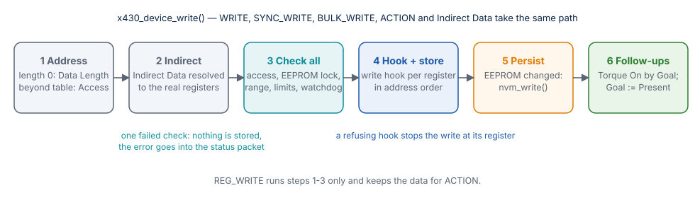
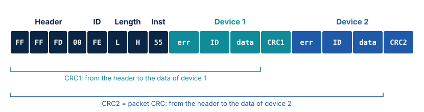
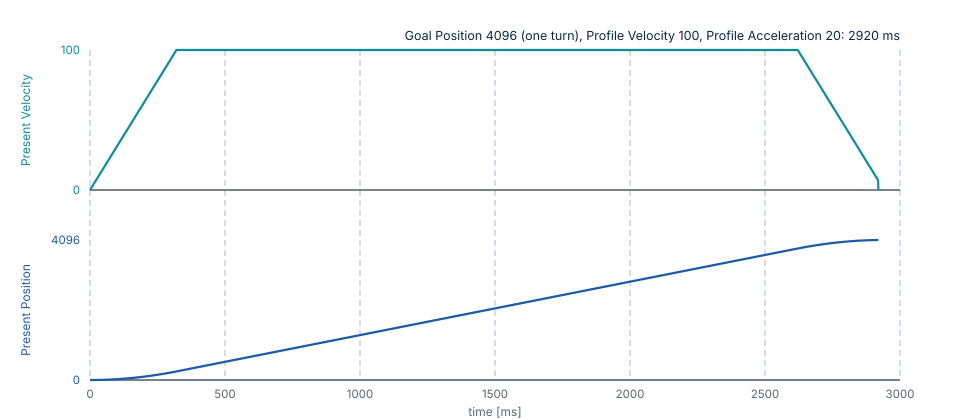

# X430 Emulation

This chapter describes what a host sees: the Control Table model, how each instruction is
executed, the rules a real X430 enforces and how the library reproduces them, the format
of the persistent blocks, and the kinematic model of the simulator with its equations.
Every rule is taken from the code (`src/`) and checked by the unit tests in `tests/unit/`;
the measured results come from `tests/unit/gtest_x430_sim.cpp` and from the DynamixelSDK
check in `tests/sdk/`.

## The Control Table model

`models/x430_family.yaml` holds the Control Table shared by the X430 family (662
addresses, two Indirect Address blocks of 28 entries) with two variants:

| Variant | Models | Current registers | Operating modes |
| --- | --- | --- | --- |
| `current` | XM430, XH430, XD430, XW430 | Current Limit (38), Goal Current (102), Present Current (126) | 0, 1, 3, 4, 5, 16 |
| `load` | XL430, XC430, 2XL430, 2XC430 | Present Load (126) only | 1, 3, 4, 16 |

`models/x430/<model>.yaml` lists what differs: Model Number, variant, removed registers
(LED on the XW430) and initial values or ranges. `tools/x430_gen_model.py` merges both,
validates the result (sizes, overlaps, EEPROM below address 64, a check for every writable
register) and writes `x430_model_table.c` with the register list and an address map (one
byte per address: register index + 1, 0 = reserved).

Every register has a write check:

| Check | Valid values | Registers (examples) |
| --- | --- | --- |
| range | min..max | ID (0..252), Return Delay Time (0..254), limits |
| mask | only the bits of a mask | Drive Mode (bits 0, 2, 3), Shutdown |
| opmode | an operating mode of the model | Operating Mode (11) |
| symmetric | −limit..+limit, the limit is another register | Goal PWM (±36), Goal Current (±38), Goal Velocity (±44) |
| goal position | Min..Max Position Limit (52, 48) in mode 3; ±1,048,575 in the other modes | Goal Position (116) |
| indirect | RAM address 64..661 | Indirect Address 1–56 |

`tests/models` compares every model with a snapshot of the e-Manual control tables (size,
access, area, initial value and range of every register). Differences are allowed only
where the emulator deviates on purpose:

| Item | e-Manual | Emulator | Why |
| --- | --- | --- | --- |
| Protocol Type (13) | 1–2 | 2 only | Only Protocol 2.0 is emulated |
| Protocol Type initial on XW | 1 | 2 | Same; the XW description names 2 as the default |
| Secondary ID (12) range | 0–252 | 0–255 | 253–255 disable the function (as described) |
| Bus Watchdog (98) range | 1–127 | 0–127 | 0 disables and clears the error (as described) |
| XW430-T200 Model Number | 1,270 | 1,280 | The table repeats the number of the XW430-T333; ROBOTIS tools use 1,280 |
| ID write that collides with another emulated device | accepted | Data Range Error | Two local devices with one ID would answer together |
| Partial write of a multi-byte register | – | bytes are merged | Not specified; the whole new value is checked |

## Addressing and status packets

- A packet to an ID is executed by the device with that **ID**; only it answers.
- Devices whose **Secondary ID** (12) equals the packet ID execute it silently; they refuse
  EEPROM writes and FACTORY_RESET. Values 253–255 disable the Secondary ID.
- **Broadcast** (0xFE): PING is answered by every device in ascending ID order; WRITE,
  REG_WRITE, ACTION, REBOOT, CLEAR, BACKUP and FACTORY_RESET (not option 0xFF) are executed
  silently; READ is ignored.
- Status packets of other devices on the line are ignored.
- **Status Return Level** (68): 0 = PING only, 1 = PING and READ (also the group reads),
  2 = all. The level written by an instruction already applies to its own answer.
- **Return Delay Time** (9) × 2 µs is waited through `x430_port::delay_us` before each
  answer.
- The **alert bit** (0x80) is set in the error byte of every status while Hardware Error
  Status (70) is not 0.
- REBOOT and FACTORY_RESET answer first, then act. After an ID change the answer still
  comes from the old ID.

## Writes

1. A length of 0 is a Data Length Error; a range beyond the table an Access Error.
2. Bytes written through Indirect Data are resolved to the addresses they point at.
3. Every register the write touches is checked with its new value (the bytes of the write
   merged into the current bytes). Errors: Access (read-only, EEPROM while the torque is
   on, EEPROM through the Secondary ID), Data Range (value, limit registers, a goal while a
   Bus Watchdog error is active), Result Fail (Torque Enable after a shutdown). If one check
   fails, nothing is stored.
4. In address order the write hook is called for each register; it may refuse, which stops
   the write at that register. Accepted registers are stored.
5. If an EEPROM register changed, the EEPROM area is stored through `nvm_store`; a failure
   is reported as Result Fail.
6. Drive Mode bit 3: a goal written with the torque off switches the torque on (through the
   write hook). Torque Enable 0 → 1 copies Present Position into Goal Position.

Reserved addresses read as 0 and ignore writes. REG_WRITE runs steps 1–3, keeps up to
`X430_REG_WRITE_SIZE` bytes and sets Registered Instruction (69); ACTION runs the whole
write. A Baud Rate change raises `X430_EVENT_BAUD_RATE` after the status packet, so the
answer still leaves at the old rate.

## Indirect Address and Data

Indirect Address 1–28 (168–222) map Indirect Data 1–28 (224–251), and 29–56 (578–632) map
634–661. An Indirect Data byte behaves like the byte it points at (size, range and access
are those of the target register); a byte that points at Indirect Data itself is plain
storage. ROS 2 `dynamixel_hardware_interface` uses this to read Present Position and
Present Velocity with one Fast Sync Read; the DynamixelSDK check does the same.

## Lifecycle

| Situation | EEPROM area (0–63) | RAM area (64–661) |
| --- | --- | --- |
| `x430_device_init()` | Factory values, then the stored block | Factory values, then the Startup Configuration |
| REBOOT | Kept | Factory values, then the Startup Configuration; errors cleared |
| FACTORY_RESET 0xFF / 0x01 / 0x02 | Factory values (keep the ID / keep ID and Baud Rate) | As REBOOT |
| BACKUP 0x01 | – | Whole table stored, Backup Ready (147) = 1 |
| BACKUP 0x02 (torque off) | Restored except ID, Baud Rate, Protocol Type | Restored except Torque Enable, Bus Watchdog |

Startup Configuration (60): bit 1 restores the RAM area from a valid backup, bit 0
switches the torque on (through the write hook). FACTORY_RESET 0xFF gives the device its
factory ID from `x430_device_config::id` — or the model default 1 when that ID is used by
another device of the bus.

### Bus Watchdog

With Torque Enable = 1 and Bus Watchdog (98) = 1..127, the device expects an instruction
packet at least every $T_{\mathrm{wd}} = 20\,\mathrm{ms} \times$ Bus Watchdog. The time
since the last instruction packet is compared in `x430_bus_poll()` and on the next packet;
when it is exceeded, Bus Watchdog reads 0xFF (−1), the event `X430_EVENT_BUS_WATCHDOG`
fires and the goal registers answer Data Range Error until Bus Watchdog is written again.
The resolution is the period of `x430_bus_poll()`.

### CLEAR

Option 0x01 with the magic bytes `44 58 4C 22` clears the multi-turn information of Present
Position. It is refused with Result Fail while Moving (122) is 1. The event hook does the
work (the simulator moves its shaft); without an event hook the library wraps Present
Position into 0..4095.

## Group instructions

- **SYNC_READ / BULK_READ:** one status packet per hosted device, in the order of the
  request; IDs that are not hosted are skipped.
- **FAST_SYNC_READ / FAST_BULK_READ:** one status packet with ID 0xFE. Per device it
  carries `[error, ID, data, CRC]`; each CRC covers the packet from the header up to that
  point, and the last one is the packet CRC. The packet is not byte-stuffed, as
  DynamixelSDK expects.

- **SYNC_WRITE / BULK_WRITE:** applied to the hosted IDs without status; a malformed
  BULK_WRITE is ignored as a whole.

A Fast read answers only for the IDs of this bus: keep all IDs of one ROS 2 hardware
component on the same emulator bus.

## Persistent blocks

The library hands the application opaque blocks; their layout is fixed so that a block of
another model or a damaged flash page is detected:

| Offset | Size | Content |
| ---: | ---: | --- |
| 0 | 4 | Magic `X430` |
| 4 | 2 | Model Number (little endian) |
| 6 | 1 | Format version (1) |
| 7 | 1 | Slot: 0 EEPROM area, 1 backup |
| 8 | 2 | Payload size: 64 (EEPROM area) or 662 (whole table) |
| 10 | n | Payload: the table bytes 0..n−1 |
| 10 + n | 2 | CRC-16 of DYNAMIXEL Protocol 2.0 over bytes 0..9+n |

A block with any field that does not match is ignored: the device keeps its factory
values. The EEPROM block is 76 bytes (`X430_NVM_EEPROM_SIZE`), the backup 674 bytes
(`X430_NVM_BACKUP_SIZE`).

## The simulator

The simulator replaces the motor with a kinematic model that follows the X430 profiles. It
works in integer units: the shaft position $s$ in 1/1000 pulse (4,096 pulses per turn) and
the shaft velocity $v$ in 1/1000 pulse per second, advanced in steps of $\Delta t$ = 1 ms.
The register units convert as

$$
\begin{aligned}
u_v &= 0.229\,\tfrac{\mathrm{rev}}{\mathrm{min}} = 15{,}633\ \tfrac{\mathrm{mpulse}}{\mathrm{s}} \\
u_a &= 214.577\,\tfrac{\mathrm{rev}}{\mathrm{min}^2} = 244{,}140\ \tfrac{\mathrm{mpulse}}{\mathrm{s}^2}
\end{aligned}
$$

### Position modes (3, 4, 5)

With $g$ the Goal Position on the shaft ($(\text{Goal Position} - \text{Homing Offset})
\times$ direction $\times 1000$), $V$ the profile speed (Profile Velocity $\times u_v$, or
Velocity Limit $\times u_v$ when Profile Velocity is 0) and $A$ = Profile Acceleration
$\times u_a$, each step $k$ computes

$$
\begin{aligned}
e_k &= g - s_k, \qquad d_k = \lvert e_k \rvert \\
r_k &= \min\!\left(1000\, d_k,\ \sqrt{2 A \min(d_k, 10^9)},\ V\right) \\
v_{k+1} &= v_k + \operatorname{clamp}\!\left(\operatorname{sgn}(e_k)\, r_k - v_k,\ -\tfrac{A}{1000},\ \tfrac{A}{1000}\right) \\
s_{k+1} &= s_k + \left\lfloor v_{k+1} / 1000 \right\rceil_0
\end{aligned}
$$

where $1000\,d_k$ is the speed that arrives within one step, the square root the fastest
speed that can still brake to standstill at the goal, and $\lfloor\cdot\rceil_0$ a
division truncated toward zero. With $A = 0$ the velocity jumps to its target. When the
remaining distance is not larger than the step (or below half a pulse) the shaft is placed
on the goal and $v = 0$. The square root is an integer square root (at most 32 iterations).
Drive Mode bit 2 (time-based profile) is treated like the velocity-based profile.

The curve is computed by `tools/docs/diagrams.py` with the same integer arithmetic.

### Velocity, PWM and current modes (1, 16, 0)

The target velocity is Goal Velocity $\times u_v$ (mode 1), Goal PWM / PWM Limit $\times$
Velocity Limit $\times u_v$ (mode 16) or Goal Current / Current Limit $\times$ Velocity
Limit $\times u_v$ (mode 0), limited to ±Velocity Limit $\times u_v$ and ramped with $A$ as
above; the shaft advances by $\lfloor v/1000 \rceil_0$ per step. With the torque off the
velocity is 0 and the shaft holds its position.

### Live registers

After the steps of `x430_sim_step()` the simulator writes

| Register | Value |
| --- | --- |
| Present Position (132) | $\mathrm{round}(s/1000) \times$ direction + Homing Offset |
| Present Velocity (128) | $\mathrm{round}(v \times \text{direction} / u_v)$ |
| Present Current / Load (126) | Velocity change of the last step in $u_v$, limited to Current Limit (or ±1000 for Present Load) — a rough stand-in for the effort |
| Present PWM (124) | Present Velocity / Velocity Limit $\times$ 885 |
| Moving (122), Moving Status (123) | 1 and Profile Ongoing while the shaft turns or a Goal Position move is not done; In-Position, profile type (step, rectangular, triangular, trapezoidal) |
| Velocity / Position Trajectory (136 / 140) | The target velocity; Goal Position in the position modes |
| Present Input Voltage (144), Present Temperature (146) | From `struct x430_sim_config` |

Direction is −1 with Drive Mode bit 0 (reverse), +1 otherwise.

### Measured

| Scenario (test) | Simulator | Closed form | Difference |
| --- | ---: | ---: | ---: |
| Move of 4,096 pulses, Profile Velocity 100, Profile Acceleration 20 (`TrapezoidalMoveTimeMatchesTheClosedForm`), $T = d/v + v/a$ | 2,920 ms | 2,940.3 ms | −0.69 % |
| Velocity ramp 0 → 100, Profile Acceleration 5 (`VelocityRampTimeMatchesTheClosedForm`), $t = v/a$ | 1,275 ms | 1,280.7 ms | −0.45 % |

The peak Present Velocity of the move is exactly the Profile Velocity (100). The move ends
slightly early because the last steps place the shaft on the goal as soon as it is closer
than one step. The tests accept ±1 %.

## Limits of the emulation

- Motion, current control and PID gains belong to the motor: the library stores the gains
  and limits, the application applies them.
- Present Input Voltage and Present Temperature are not compared with their limits by the
  library: the application raises the hardware error.
- Only Protocol 2.0; Protocol Type accepts 2 only.
- One model per build; all devices of a build emulate the same model.
